# FrameWink 1.6.1 — complete screenshot gallery

All 19 cards below have been compared with build 80. Seven outdated interfaces were refreshed from new native Simulator captures; twelve cards retain their approved bytes. These are review candidates, with original galleries and approval locks preserved. See [the per-card parity audit](Screenshot-Parity-2026-10-24.md) for observations and capture evidence. Native Book/Tabletop and blackout verification and TestFlight hardware acceptance remain separate.

Run `sh scripts/validate_app_store_assets.sh` from the repository root for strict inventories, dimensions, opacity, uniqueness, all 23 original approval hashes, and the 19 candidate/nine source checksums. New checksums record file integrity and do not imply artwork approval.

## iPhone · 6.9-inch — 6 images

### 01 · Beautifully framed

Retained · current UI verified.

### 02 · Made for every screen

Retained · current UI verified.

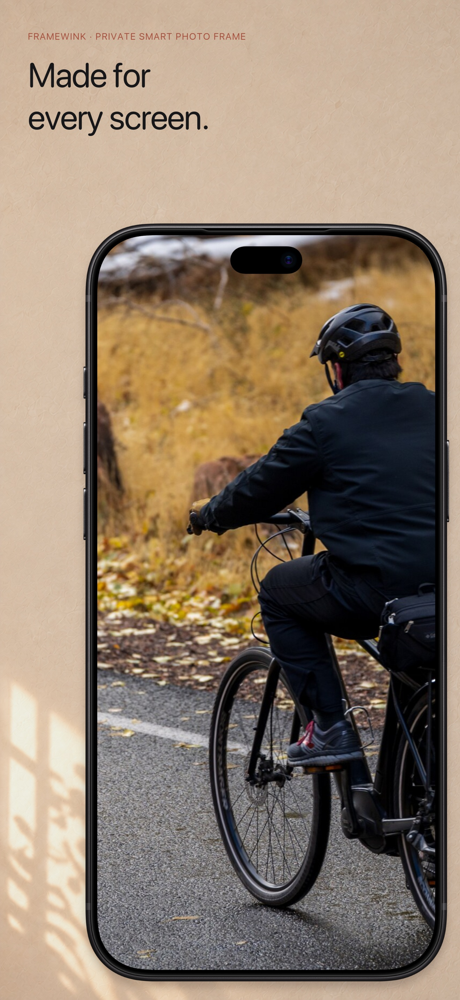

### 03 · Choose an album

Refreshed from build 80.

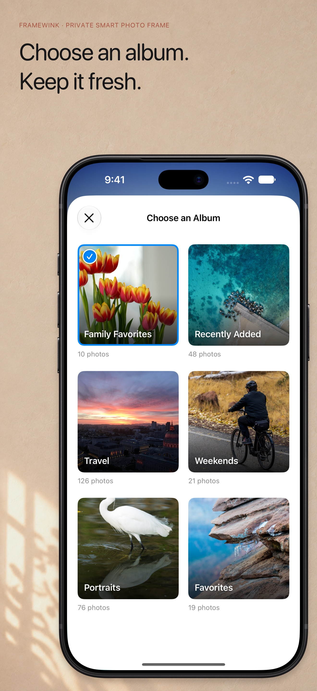

### 04 · Portrait or landscape

Retained · current UI verified.

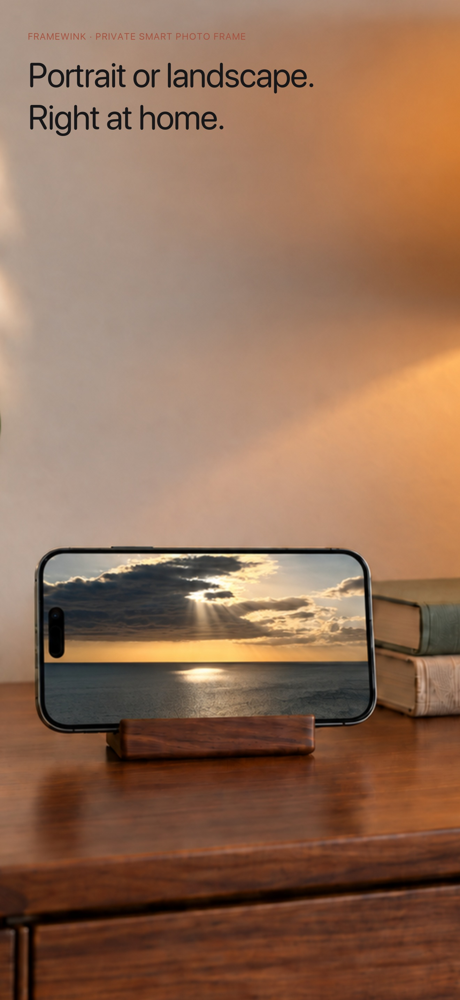

### 05 · Simple controls

Refreshed from build 80.

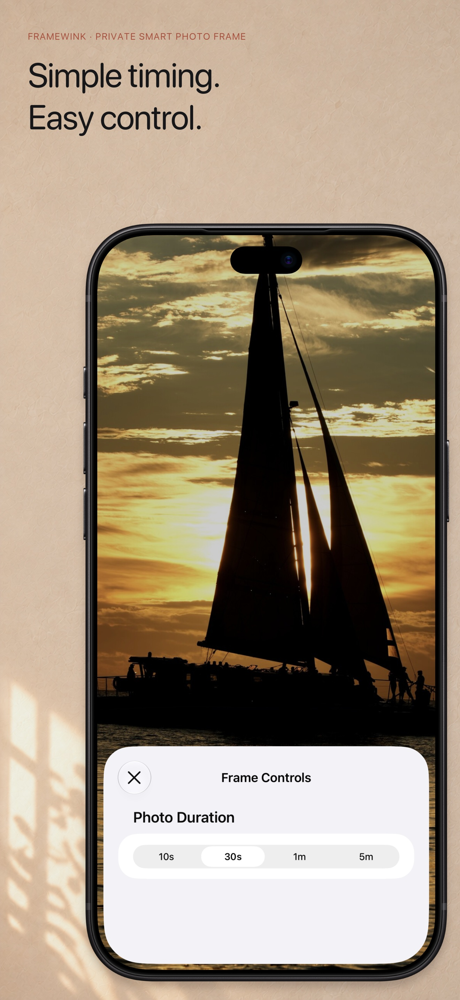

### 06 · See it first

Refreshed from build 80.

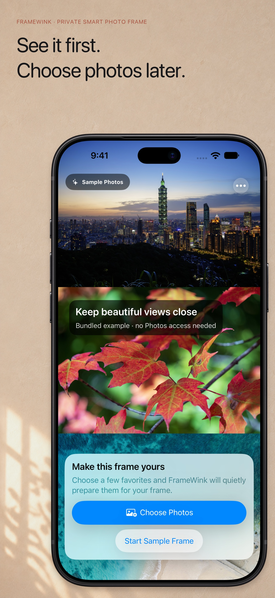

## iPad · 13-inch — 7 images

### 01 · Beautifully framed

Retained · current UI verified.

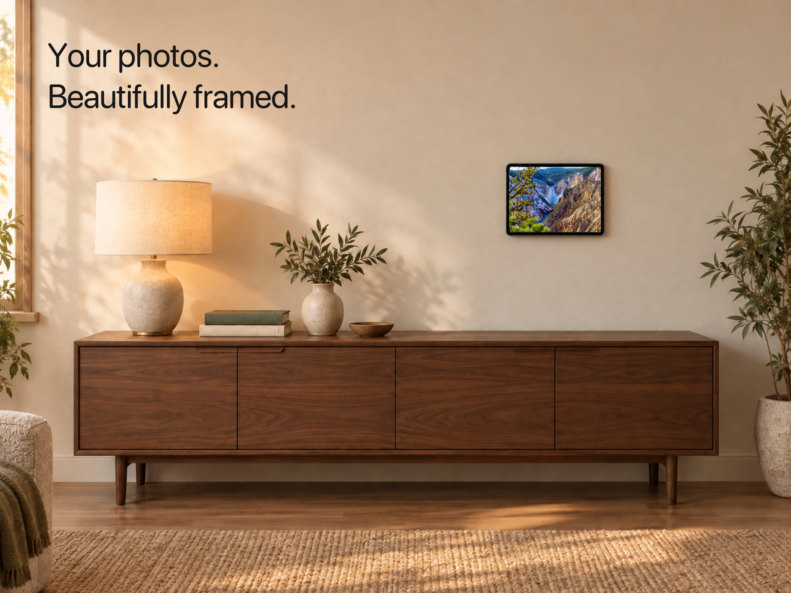

### 02 · Wall or table

Retained · current UI verified.

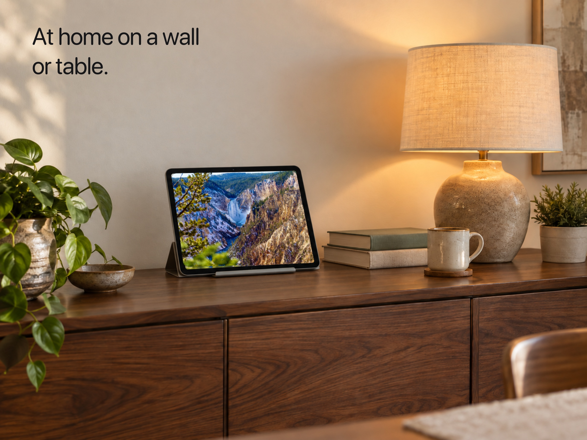

### 03 · Beautifully framed

Retained · current UI verified.

### 04 · Beautifully arranged

Retained · current UI verified.

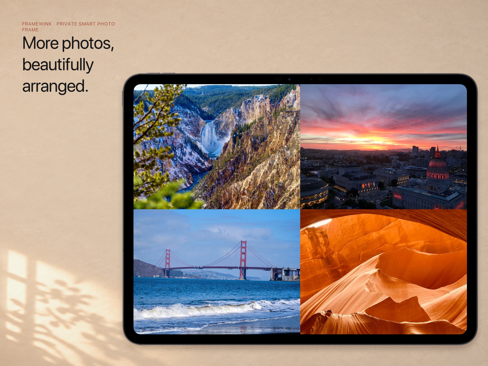

### 05 · Choose an album

Refreshed from build 80.

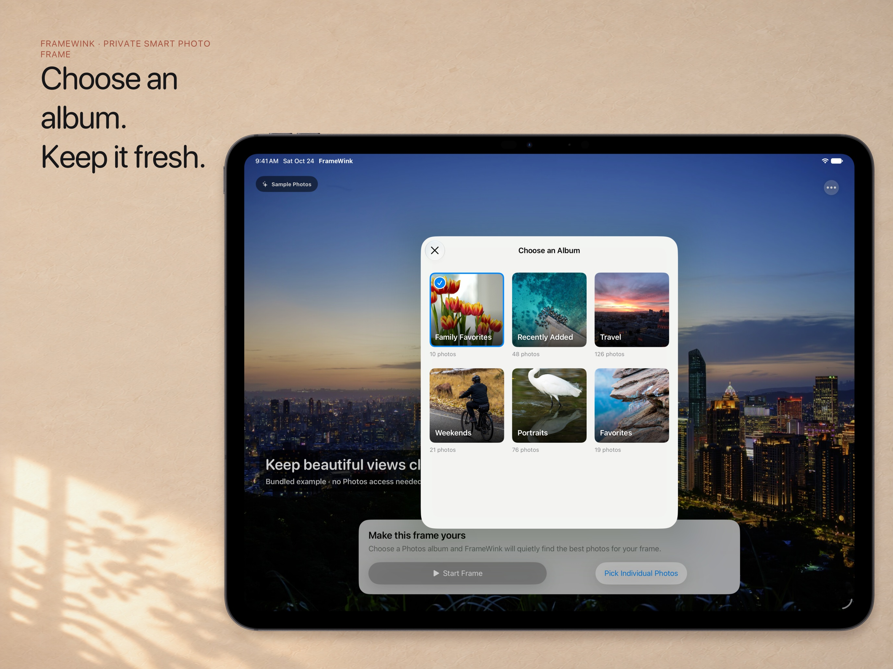

### 06 · Simple controls

Refreshed from build 80.

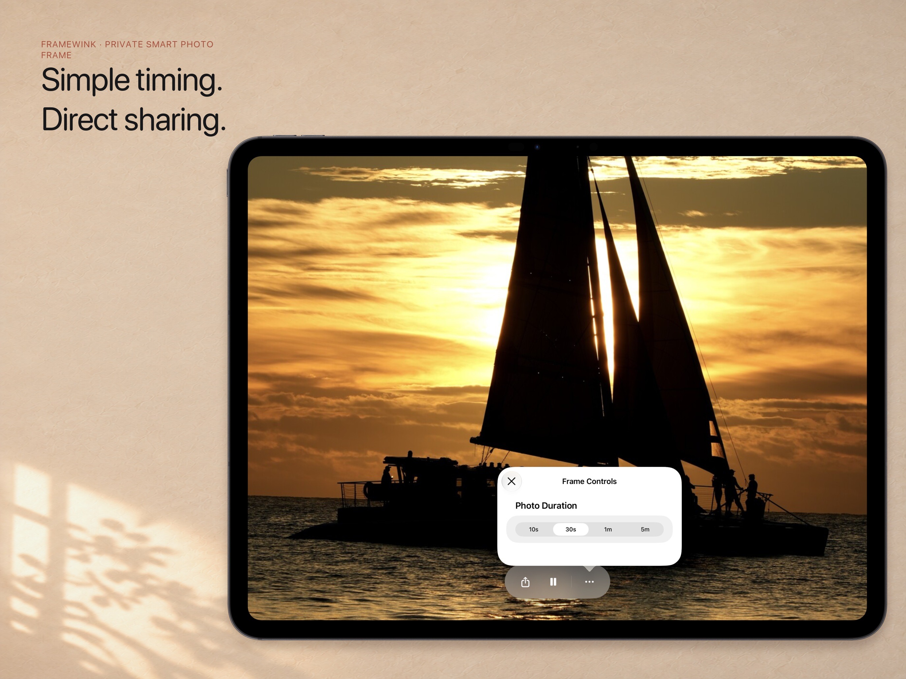

### 07 · See it first

Refreshed from build 80.

## iPhone Duo — 6 images

### 01 · Your photos beautifully framed

Retained · current UI verified.

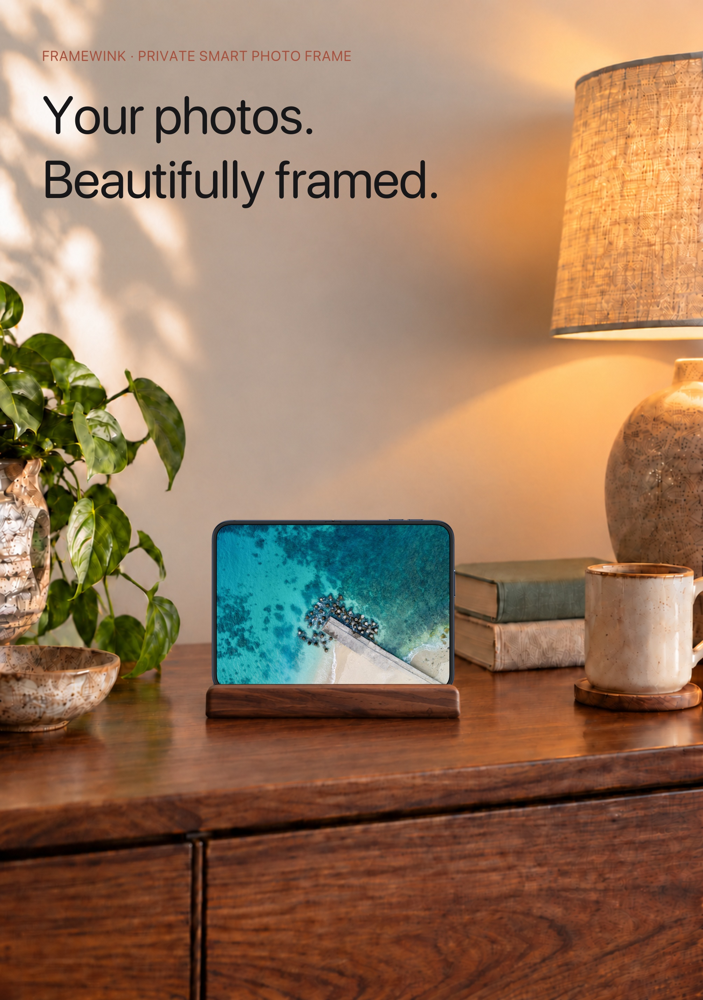

### 02 · Open to a bigger frame

Retained · current UI verified.

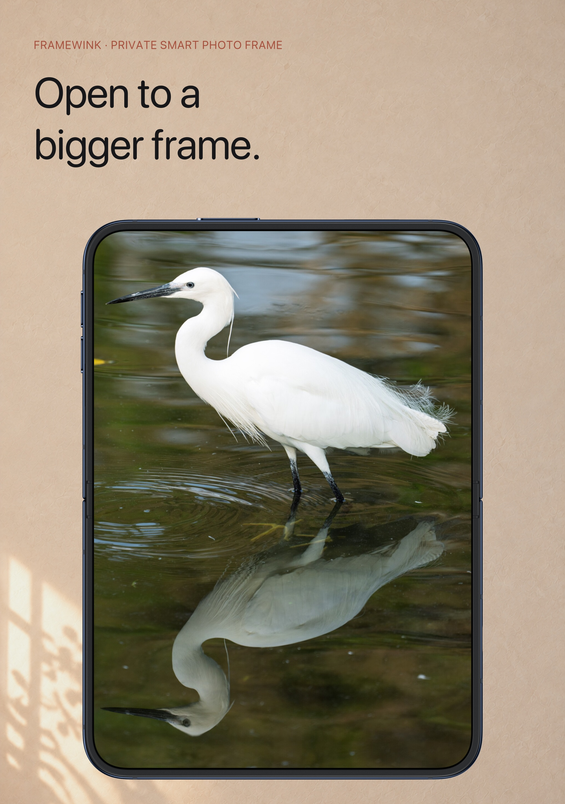

### 03 · Choose an album

Retained · current UI verified.

### 04 · Open or closed

Retained · current UI verified.

### 05 · Simple timing

Retained · current UI verified.

### 06 · See it first

Refreshed from build 80.

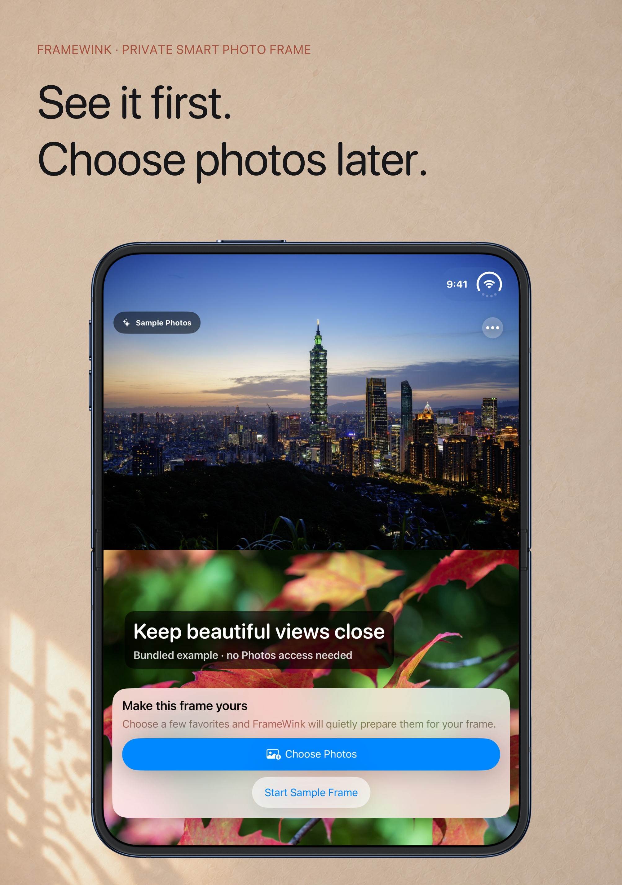
