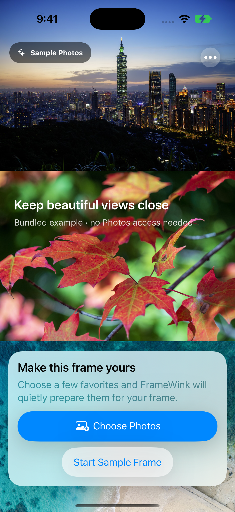
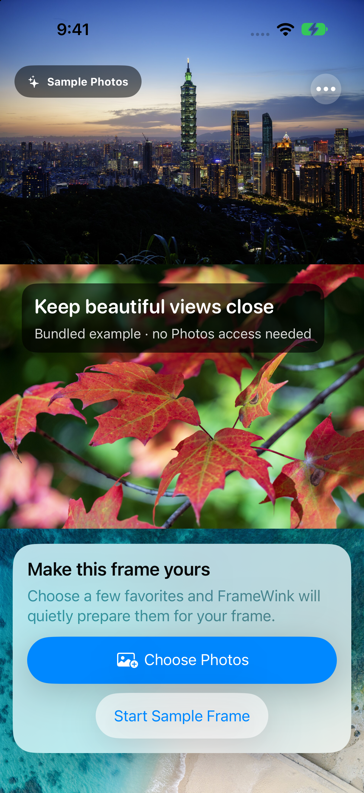

# Duo interaction improvements — review evidence

This working evidence accompanies the first app in the five-app iPhone Duo support goal. Physical acceptance is pending a shared end-of-session pass across all five apps. This PR must remain in draft until its required hardware checks and final comparisons pass.

The patch keeps photo presentation on the upper/leading half and adds useful browsing on the lower/trailing half. Swipe there to move between photos while preserving the existing pause state; playback controls remain visible while separated from the photo. The current-position heading stays beside Exit; a supplemental swipe hint appears when it fits, uses concise accessibility-size copy, and keeps the playback buttons clear. Decorative control symbols keep bounded sizes while their accessibility labels/actions and 44-point touch areas remain available. Full-screen playback retains auto-hide, and scheduled blackout remains dark until controls are explicitly requested. Native reserved-region frames already include margins; use those frames directly to recover space without losing hinge clearance.

## Matched Simulator caption comparison

Same initial sample page, iPhone 18 Pro, iOS 27.0, light appearance, standard Large text, portrait, hidden keyboard. The base is `c3614aab98817a3eb5da24b962609937ab41a667`; candidate native inputs are recorded separately and must be verified against the final commit. System status bar/Dynamic Island rendering differs and is not app content. The caption and setup card remain readable and reachable.

| Before | After |
| --- | --- |
|  |  |

## Companion controls during iteration

This image uses an explicit horizontal-division DEBUG fixture on an ordinary iPhone Simulator. It demonstrates the lower control surface and is **not** native Duo fold detection, Book/Tabletop posture evidence, or physical acceptance. The fixture requires an explicit sample scenario and environment flag and is excluded from Release builds.

## Largest accessibility text size

Position text keeps the full requested Dynamic Type size. The shortened visible hint and bounded decorative symbols leave controls clear; the complete browsing hint and previous/next actions remain in accessibility. A hint may be omitted when the control region is too short, while position and actual browsing input remain available. Visual comparisons use rendered images; SwiftUI can merge parent padding into static-text accessibility bounds, so those bounds are not treated as drawn-glyph rectangles.

## Validation status

- Unchanged base: 56 focused geometry/playback/layout checks passed.
- Candidate: 61 focused checks passed, including lower-surface browsing while paused, persistent controls while playing, blackout escape/recede behavior, and paused browsing at the largest accessibility text size.
- Earlier candidate full ordinary iPhone: 247 passed, zero failures, four existing physical-only skips. That broad run was intentionally stopped during iPad testing after a confirmed AX5 layout finding; it is not a final-revision gate.
- Final full iPhone, iPad and native Duo suites: pending on the corrected source; retain their final result summaries before accepting.
- Release build and static analysis: passed. The test-division flag is absent from the Release binary.
- Physical baseline: ten landing positions plus control sheets and paused foreground transitions preserved. Existing continuity already worked; this patch does not claim to fix a fold-reset defect.
- Final hardware checks, ten final landing positions, manual Book/Tabletop gestures, VoiceOver behavior and workflow transitions: pending shared five-app session. Public XCTest could not reliably deliver inner-display taps in the earlier audit.

No user Photos, health information, receipts, connection details, credentials, signed apps, or raw device metadata are included in this review evidence. Screenshots use only bundled sample photographs. PRs remain unmerged; no release or App Store submission is authorized.
