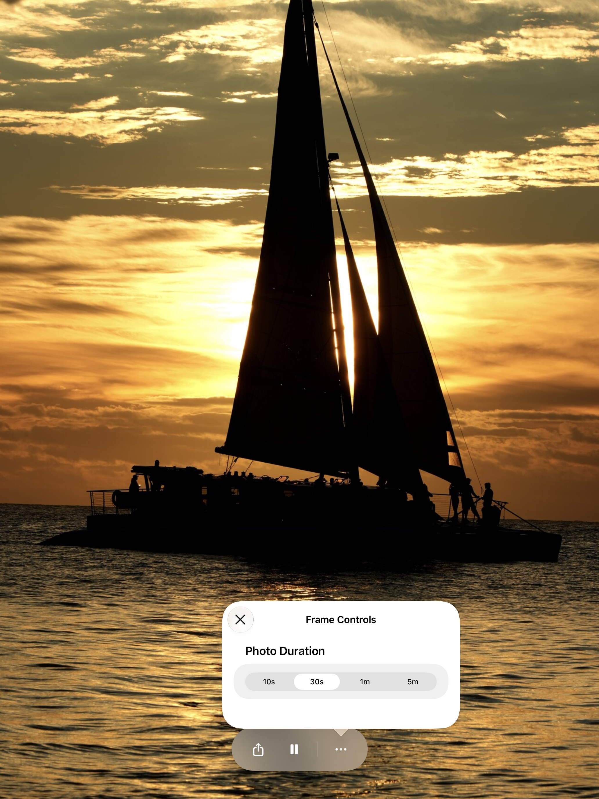
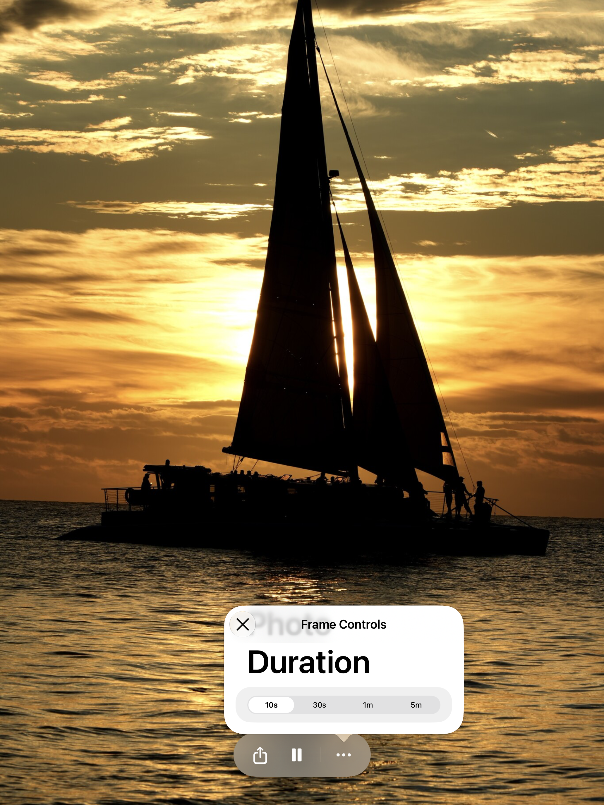

Latest approved follow-up: [preserve More at scheduled blackout onset](blackout-transition/README.md), validated source `80fddd95103e4140db8f233eabe8580c3f697ec3`. The earlier report below retains its original revision and results.

# FrameWink control visibility review fixes — October 24, 2026

Validated source: `9f0cc83c619058a252d690187823f34d86c65abd`. Reviewed baseline: `534e380541ab31a0fddef0900038865768129f0f`; latest main remains `c3614aab98817a3eb5da24b962609937ab41a667`, already integrated. The baseline reproduction adds only the [neutral DEBUG fixture and UI harness](baseline-neutral-fixture.patch); all other recorded native inputs match the retained implementation. Prior captures and provenance remain unchanged.

During playing sample playback, opening More in a divided layout and unfolding removed its presenter four seconds later. Auto-hide now respects the open panel when scheduling and delivering its timer. The regression keeps More open for five seconds, changes duration, confirms playback stays running, closes More and verifies ordinary auto-hide returns.

Folding into a divided layout also revealed previously hidden controls during scheduled blackout. Geometry changes now preserve blackout darkness. The regression checks the fold without a tap, then proves that an explicit lower-half tap still reveals Exit and that it recedes again.

## Matched Simulator fixture captures

Ordinary iPad Pro 13-inch (M5), iOS 27.0 / 24A434, Xcode 27.1 / 27A9275 and SDK 27.1. Same bundled sample scenario, playing, English, Large text, VoiceOver off and hidden keyboard. A DEBUG environment flag injects a portrait division; rotation to landscape removes it and drives the real production division-change callback. These fixtures establish control visibility behavior; they do not establish native Duo hinge detection or physical fold acceptance.

| Reviewed baseline five seconds after fixture unfold | Fixed source five seconds after fixture unfold |
| --- | --- |
|  |  |

| Reviewed blackout after fixture fold, without tap | Fixed blackout after fixture fold, without tap |
| --- | --- |
|  |  |

## Dynamic Type runtime result

The suspected popover text cap was not reproduced. The Photo Duration heading's accessibility frame height grows from 44 points at Large to 151 points at AX5, and the native screenshots show the enlarged text. No Dynamic Type production change was made. At AX5, the compact popover's Form scrolls to its duration picker.

The initial diagnostic incorrectly required the unscrolled picker to be hittable. Subsequent element gestures failed with XCTest's "visible frame is empty" error; the retained hierarchy includes a zero-sized ancestor above the visibly rendered popover. The final diagnostic uses actual window-coordinate drag/tap input derived from the observed Form/navigation/button frames, then asserts that 10s is selected and the panel dismisses after Close. It passes. Failed attempts remain retained locally.

| Baseline Large | Baseline AX5 | Fixed source AX5 after scrolling and selecting 10s |
| --- | --- | --- |
|  |  |  |

## Exact check results

| Run | Pass | Fail | Skip | Evidence boundary |
| --- | ---: | ---: | ---: | --- |
| Reviewed source + neutral fixture, iPad | 0 | 3 | 0 | Both visibility regressions reproduce; unscrolled AX5 picker assertion also fails |
| Fixed source, iPad focused checks | 68 | 1 | 0 | 58 logic and 10 UI passes; AX5 header gesture fails in XCTest |
| AX5 Form-element gesture follow-up | 0 | 1 | 0 | Same app inputs; XCTest rejects the visible collection view gesture |
| AX5 observed-coordinate follow-up | 1 | 0 | 0 | Requested text size, actual duration selection and dismissal pass |
| Ordinary iPhone focused checks | 62 | 0 | 0 | 58 logic + More/timing/share, blackout escape, free/paid duration persistence; reused test products |

All candidate invocations use identical production inputs. Only the diagnostic UI harness changed between the failed gesture attempts and the successful coordinate check. The original 69-case iPad run remains failed, and no single clean rerun of that entire selection is claimed. Test result summaries record zero runtime warnings; Xcode's SDK-build/debugger-lookup diagnostics remain in retained logs.

[Sanitized capture/source provenance](provenance.json) records exact input and image hashes. Detailed build commands, native results, original app products, screenshots and failed attempts remain in the local per-app report. This focused check does not replace historical full suites or resolve their retained native Duo failures. New native Duo transitions were not rerun in this constrained pass. Physical follow-up remains TestFlight-only; no upload, physical device operation, merge or release occurred. PR #31 remains draft and unmerged.
