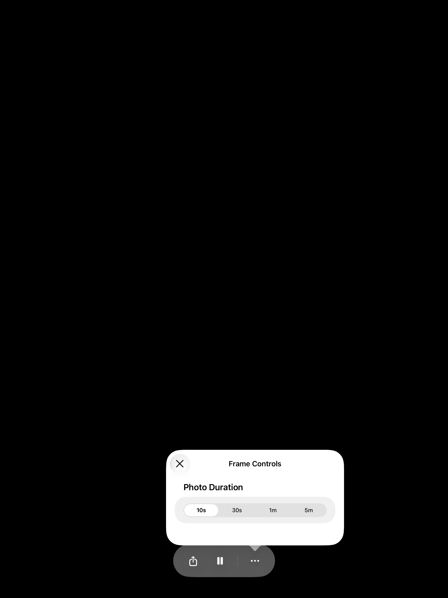

# Preserve More when scheduled blackout begins

Validated source: `80fddd95103e4140db8f233eabe8580c3f697ec3`. Reviewed baseline: `d97cd4852ebda8e071359de5572778037832058c`. Main remains `c3614aab98817a3eb5da24b962609937ab41a667`, already included. This is an additional user-approved repair; the [earlier control visibility evidence](../README.md) keeps its original results and source identities.

The reviewed app removed the frame-controls subtree when blackout set `controlsVisible` to false, also removing the presenter of an already-open More panel. The fix keeps that subtree alive while `isShowingFrameControls` is true. The blackout observer still marks ordinary controls hidden, so dismissing More leaves the frame dark without waiting for another four-second timer.

## Reproduction and checks

The ordinary iPad baseline failed at the exact assertion: “Scheduled blackout must retain an already-open More presenter.” Its native screenshot shows the open panel before blackout and its disappearance after blackout. The corrected source passed **33 tests, zero failures or skips**: 28 playback/schedule logic checks and five UI checks. Between the instrumented baseline and candidate runs, the only changed native input is `SampleSlideshowView.swift`; the fixture and assertions are identical.

Both new UI cases open More during playing playback and select 10s with actual input. After the real schedule evaluator publishes blackout, they wait five seconds, verify the panel remains and 10s stays selected, select 1m, close More and verify blackout has no toolbar, Exit or companion navigation. A deliberate tap then reveals Exit, which recedes again. One case uses the ordinary viewport; the other uses the existing explicit horizontal division fixture. Three retained UI cases also pass: open More across fixture unfold, blackout darkness across fixture fold, and separated blackout escape/recede.

| Run | Passed | Failed | Skipped |
| --- | ---: | ---: | ---: |
| Reviewed source + neutral schedule clock, ordinary iPad | 0 | 1 | 0 |
| Fixed source, same clock/harness, focused iPad selection | 33 | 0 | 0 |

The 28 logic tests are `FrameSessionControllerTests` (19), `WallModeControllerTests` (5) and `WallScheduleEvaluatorTests` (4). Source inputs stayed unchanged during compilation and both runtime invocations. All 133 final native inputs match the validated source. Summaries report zero runtime warnings; Xcode's existing SDK-build/debugger-lookup diagnostics remain in retained logs.

## Matched native Simulator captures

Ordinary iPad Pro 13-inch (M5), iOS 27.0 / 24A434, Xcode 27.1 / 27A9275 and SDK 27.1. Same bundled sailboat sample, playing, English, Large text, VoiceOver off, hidden keyboard and test actions. These app screenshots are captured five seconds after blackout becomes active, before the subsequent 1m selection.

| Reviewed source: panel removed | Fixed source: panel retained | Fixed source after Close |
| --- | --- | --- |
|  |  |  |

## Fixture and limits

The [neutral fixture patch](baseline-neutral-fixture.patch) adds an explicit DEBUG flag to the existing sample scenario. It seeds a schedule one hour ahead; a real duration change makes `RootView` pass an advanced date to `WallModeController.refresh`. The existing schedule evaluator, visual-state publication and production blackout observer run normally. Playback receives the real date throughout. This avoids waiting for a wall-clock minute and does not set blackout or presentation state directly.

The divided case injects the existing geometry fixture on this ordinary Simulator. This pass establishes the scoped SwiftUI behavior, not native Duo hinge detection or physical acceptance. It does not claim a new full-family suite, an additional iPhone runtime pass or a Release build. Earlier ordinary iPhone and native Duo results remain tied to their historical revisions. Physical follow-up is TestFlight-only; no hardware action, upload, merge or release occurred. PR #31 stays draft and unmerged pending fresh review.

[Sanitized source/capture provenance](provenance.json) includes input and PNG hashes. Exact commands, native result bundles, failed baseline, original and instrumented app products, and all captures remain in the local per-app report. No earlier failures or evidence were removed.
